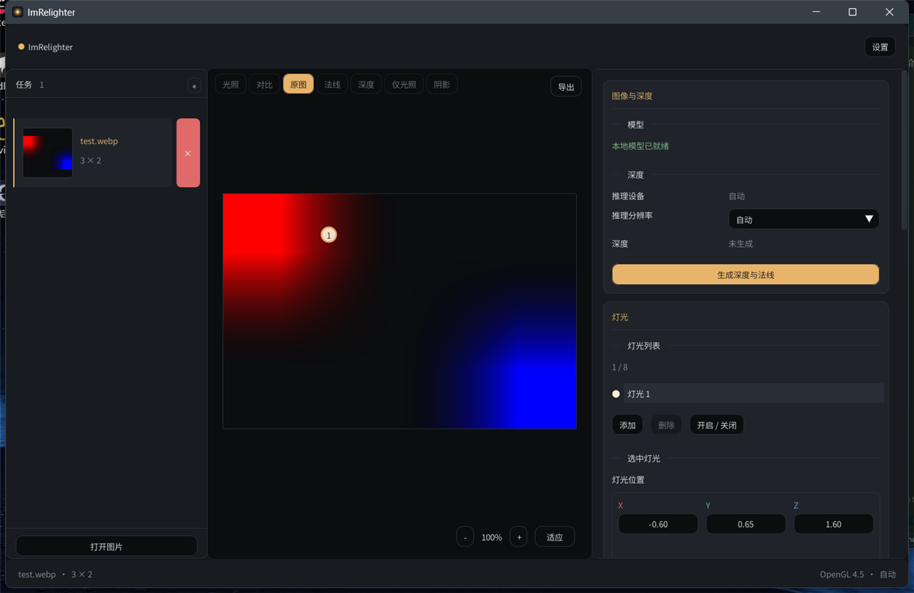

# ImRelighter 0.4.2

> 让一张图拥有可编辑的光。

ImRelighter 是 Windows 本地的单图重打光工具：在本地用 ONNX 模型估计深度，在 OpenGL 中实时拖动最多 8 盏灯，并导出光照、法线、深度、仅光照和阴影图层。



## 功能

- **本地推理**：ONNX Runtime C API，支持 CPU 与 DirectML；默认 q4 小模型，也可选择本地 FP32/FP16 或其他兼容量化模型。
- **物理光照**：GGX / 经典 Blinn-Phong 可切换，内置自然、人像、电影、经典四种方案，以及柔和 / ACES 色调映射。
- **实时渲染**：深度平滑、法线、阴影 MRT、模糊、最终光照；7 种视图与拆分对比线。
- **多任务**：PNG / JPEG / WebP，多选或拖拽打开、缩略图切换、独立参数与灯光。
- **可编辑灯光**：最多 8 盏，点光/聚光、位置、颜色、强度、范围、光锥角度与柔化；复制、独奏、开关与三点/窗光/轮廓灯组预设。
- **材质控制**：粗糙度、金属度、光泽、次表面，以及默认/皮肤/布料/头发/金属预设。
- **工作流**：复制/粘贴任务外观，`Ctrl+Z` / `Ctrl+Y` 在当前进程内撤销/重做。
- **导出**：RGBA8 光照 / 法线 / 仅光照 / 阴影，16 位灰度深度；全分辨率回读，PNG 编码异步执行。
- **桌面体验**：中文 / English、暗色 / 亮色主题、高 DPI 缩放、设置模态、非 ASCII 路径支持。
- **离线优先**：不联网、不上传图片、不自动下载模型。

## 安装

发布页提供 `ImRelighter-0.4.2-setup.exe`。安装器支持简体中文与 English，按用户安装到 `%LOCALAPPDATA%\Programs\ImRelighter`，创建开始菜单项，并可选创建桌面快捷方式。升级会复用上次选择的安装目录，保留用户模型与 `config.json`；缺失的默认模型或新增模型会补装，卸载默认保留设置与模型目录。

也可以直接解压运行目录使用，不写注册表。运行要求与安装器行为见 [docs/packaging.md](docs/packaging.md)。

## 构建

要求：

- Windows x64
- MinGW-w64 GCC 13 或更新版本
- CMake 3.26+
- Ninja
- `gcc`、`g++`、`ninja` 位于 `PATH`

```powershell
cmake --preset mingw-release
cmake --build --preset mingw-release
ctest --test-dir build/mingw-release --output-on-failure
```

Debug 构建：

```powershell
cmake --preset mingw-debug
cmake --build --preset mingw-debug
```

产物：

```text
build/mingw-release/bin/ImRelighter.exe
build/mingw-release/tests/           测试与基准程序
```

不想使用 preset 时，可直接指定生成器：

```powershell
cmake -S . -B build -G Ninja -DCMAKE_BUILD_TYPE=RelWithDebInfo
cmake --build build
```

`CMakePresets.json` 只依赖 `PATH` 中的工具链，不包含本机绝对路径。CI 配置见 `.github/workflows/windows.yml`。

生成安装器需要 Inno Setup 6.5+：

```powershell
powershell -ExecutionPolicy Bypass -File scripts/build-installer.ps1 -FetchVCRedist
```

输出为 `dist/ImRelighter-0.4.2-setup.exe` 与对应 `.sha256`。

## 运行

直接运行 `ImRelighter.exe`，或把图片路径作为参数：

```powershell
ImRelighter.exe a.png b.jpg c.webp
```

程序从 exe 同级读取 `assets/`、`models/` 与运行时 DLL；配置写入 exe 同级的 `config.json`。若目录不可写，保存设置时会显示错误。

## 常用操作

| 操作 | 快捷键 / 方式 |
|---|---|
| 打开图片（可多选 / 拖拽） | `Ctrl+O` / 拖入窗口 |
| 生成深度与法线 | `Ctrl+G` |
| 导出 | `Ctrl+E` |
| 复制 / 粘贴外观 | `Ctrl+Shift+C` / `Ctrl+Shift+V` |
| 撤销 / 重做 | `Ctrl+Z` / `Ctrl+Y` |
| 打开设置 | `Ctrl+,` |
| 适应画布 | `F` |
| 关闭设置 | `Esc` |
| 缩放 / 平移 | 滚轮 / 中键拖动 |
| 移动灯光 | 点击画布任意位置，跟随拖动 |

完整说明见 [docs/usage.md](docs/usage.md)。

## 目录

```text
assets/      字体、图标、i18n、shader
docs/        架构、构建、使用、模型、测试、打包文档与截图
extern/      固定版本的第三方源码与二进制
models/      默认 ONNX 深度模型
src/         app / core / io / ml / gpu / ui
tests/       core、GPU 金图像、i18n 检查与推理基准
```

## 文档

- [架构与数据流](docs/architecture.md)
- [构建](docs/build.md)
- [使用](docs/usage.md)
- [模型兼容性](docs/models.md)
- [测试](docs/testing.md)
- [已知限制](docs/limitations.md)
- [发布打包](docs/packaging.md)
- [变更记录](CHANGELOG.md)

## 性能参考

本机（512×512 合成输入，Depth Anything V2 Small q4，约 27 MB 模型）：

```text
CPU  556.1 ms（warmup 556.5 ms）
DML   73.7 ms（warmup 348.7 ms）
```

数值只表示相对量级，随 CPU、GPU、驱动和模型变化。基准程序：`build/mingw-release/tests/imrelighter_inference_bench.exe`。

## 许可

项目源代码采用 MIT License，见 [LICENSE](LICENSE)。模型、字体与第三方组件保留各自许可证，汇总见 [THIRD_PARTY_NOTICES.md](THIRD_PARTY_NOTICES.md)。
