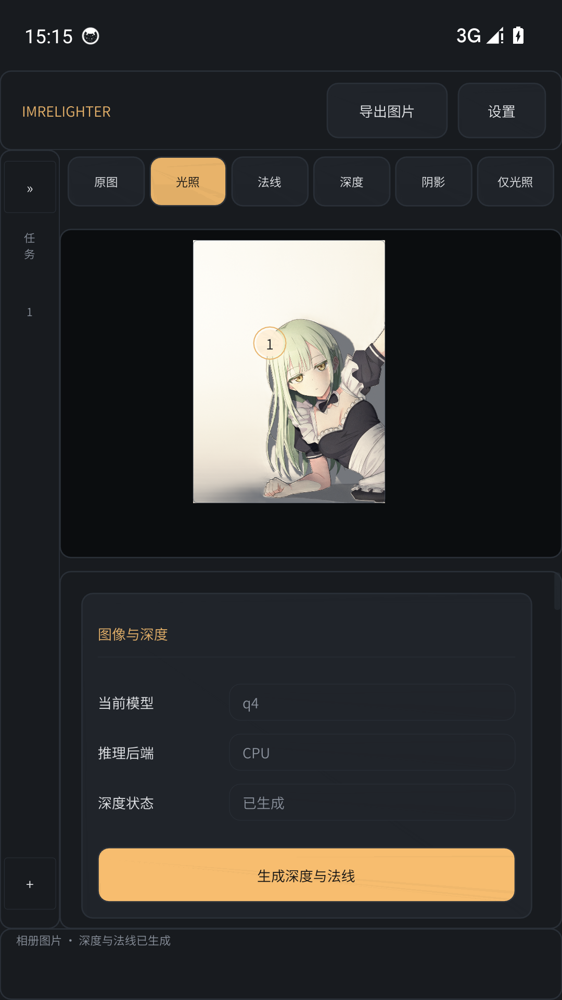
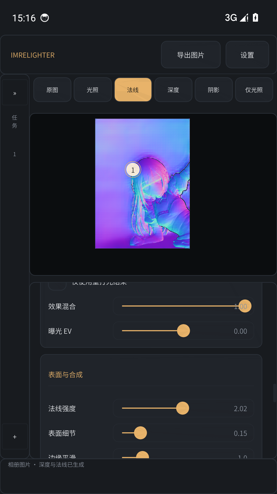
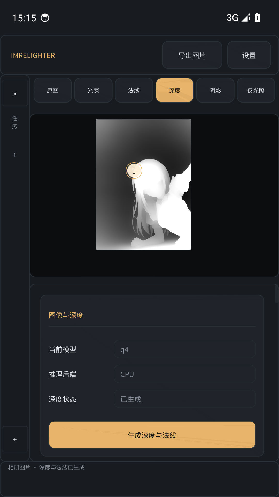
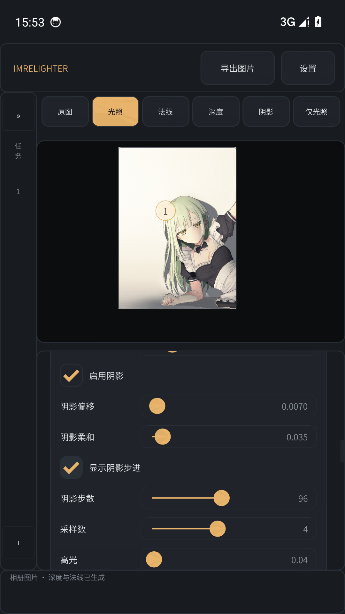

# ImRelighter Android 文档

本目录是 ImRelighter Android 版本的使用与维护文档。文档描述当前实现的实际行为；与代码或测试不一致时，以代码和测试结果为准。

ImRelighter Android 是桌面版 ImRelighter 的独立移动端实现：在手机上导入单张图片，使用 ONNX Runtime CPU 推理估计深度，在 OpenGL ES 3.1 中实时编辑最多 8 盏灯，并导出光照、法线、深度、仅光照或阴影结果。图片与推理结果不离开设备，也不需要网络。

| 文档 | 内容 |
|---|---|
| [overview.md](overview.md) | 产品定位、功能边界、模块与数据流概览 |
| [architecture.md](architecture.md) | Kotlin/JNI/原生分层、线程模型、渲染管线与任务隔离 |
| [build.md](build.md) | 工具链、Gradle/CMake 构建、产物与签名 |
| [usage.md](usage.md) | 导入、任务、深度生成、视图、灯光、参数与导出 |
| [models.md](models.md) | 内置 q4、模型目录、预处理配置与自定义 ONNX |
| [testing.md](testing.md) | 模拟器验证、回归项、GPU/推理测试现状 |
| [limitations.md](limitations.md) | 平台、模型、性能与渲染的已知限制 |
| [packaging.md](packaging.md) | APK 内容、ABI、安装与发布检查 |
| [ui-kit.md](ui-kit.md) | Dear ImGui 组件、触摸路由与主题/locale 约定 |
| [android-task-checklist.md](android-task-checklist.md) | 开发过程使用的工作清单（非正式用户文档） |

## 截图

## 当前状态

- 支持 Android 8.0（API 26）及以上、OpenGL ES 3.1；APK 包含 `arm64-v8a` 与 `x86_64`。
- 内置 Depth Anything V2 Small q4，CPU 推理；可从相册导入图片，可导入自定义 ONNX 模型文件夹。
- 实时重打光、法线、深度、阴影、仅光照五种结果视图；原图为第六种视图。
- 多任务列表、每任务独立深度/灯光/材质/视图/参数；任务保存在进程内存中。
- 主题（深色/浅色）与中英文切换可持久化；模型选择与模型目录可持久化。
- 已验证平台：x86_64 SwiftShader 模拟器。物理 arm64 设备需要最终回归。
