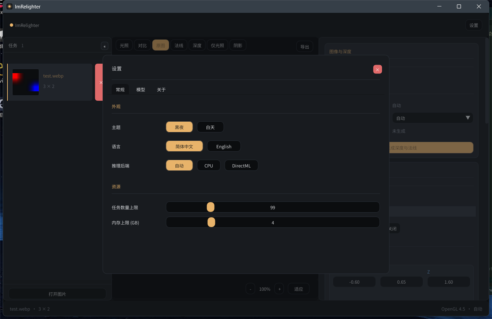

# ImRelighter 0.2.1 文档

本目录是 ImRelighter 当前实现的使用与维护文档。文档描述实际行为；与代码不一致时以代码和测试为准，并欢迎修正文档。

| 文档 | 内容 |
|---|---|
| [architecture.md](architecture.md) | 分层、模块边界、数据流、渲染管线与关键约定 |
| [build.md](build.md) | 工具链、构建、产物与运行时依赖 |
| [usage.md](usage.md) | 界面、快捷键、任务、模型选择与导出 |
| [models.md](models.md) | ONNX 模型兼容性、预处理配置与运行时假设 |
| [testing.md](testing.md) | 单元测试、GPU 金图像、i18n 检查与推理基准 |
| [limitations.md](limitations.md) | 已知限制、边界条件与未实现能力 |
| [packaging.md](packaging.md) | Setup 安装器、发布包内容、运行库、许可证与发布检查 |

## 截图

## 当前状态

- 图片加载、深度推理、实时重打光、导出与测试已实现。
- 支持 Windows x64，MinGW-w64 构建；CI 使用 GitHub Actions。
- 提供简体中文/English Setup 安装程序，也可直接使用构建产物目录。
- 程序完全本地运行，不联网、不上传图片、不自动下载模型。
